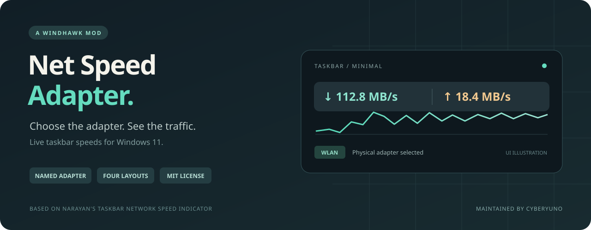

<div align="center">



# Net Speed Adapter

**Your adapter. Your traffic. Right on the taskbar.**

Live upload and download speeds for Windows, with named adapter selection and four visual layouts.

[](https://github.com/CyberYuno/windhawk-net-speed-adapter/releases/latest)
[](https://windhawk.net/)
[](LICENSE)

[Install](#install) · [Configure](#configure) · [Changelog](CHANGELOG.md) · [简体中文](README.md)

</div>

## What changes

| | Upstream 1.6 | This fork 1.6.2 |
|---|---|---|
| **Adapter selection** | Chooses the route to `8.8.8.8` | Select a Windows adapter by name, or leave blank for the upstream behavior |
| **High-speed readings** | Narrow Minimal columns can wrap and clip the unit | Wider columns and no wrapping keep three-digit MB/s readings visible |

VPN and proxy routes can make automatic selection point to a virtual adapter with very little traffic. Select your physical Wi-Fi or Ethernet adapter to monitor its total traffic directly.

The fork retains the upstream layouts, one-second default updates, adjustable position, font size and opacity, and hiding during full-screen applications.

## Install

1. Install [Windhawk](https://windhawk.net/).
2. Open [the mod source](net-speed-taskbar-adapter.wh.cpp), click **Raw**, and copy the full file.
3. In Windhawk, select **Create a new mod**.
4. Replace all of `mod.wh.cpp` with this source.
5. Click **Compile** in the sidebar, or press `Ctrl+B` while that sidebar is visible.
6. Exit editing mode after compilation succeeds. Enable **Taskbar Network Speed Indicator (Adapter Selection)**.
7. Open the mod's **Settings**, enter your network adapter name, and save.

Disable the original **Taskbar Network Speed Indicator** if installed, so only one widget is running. This fork is installed from source and is not currently listed in Windhawk's online catalog. See Windhawk's [editing mode guidelines](https://github.com/ramensoftware/windhawk/wiki/Editing-mode-guidelines).

## Configure

**Network adapter name** defaults to `WLAN`. Change it to your adapter's actual Windows name, such as `Wi-Fi`, `Ethernet`, or a localized name. To list adapters:

```powershell
Get-NetAdapter | Select-Object Name, InterfaceDescription, Status
```

Use the **Name** column, not the device description. Select the physical adapter that is connected (`Up`). A missing or disconnected named adapter produces zero readings. Leave the setting empty to restore route-based automatic selection.

Example in the mod's text settings editor:

```yaml
adapterName: Wi-Fi
theme: Minimal
horizontalPosition: 80
verticalNudge: 0
updateIntervalMs: 1000
fontSize: 16
opacity: 235
```

| Setting | Purpose |
|---|---|
| `adapterName` | Windows adapter name; blank selects automatically |
| `theme` | `Minimal`, `Top-Down`, `Side-by-Side`, or `Chart` |
| `horizontalPosition` | `0` for left, `100` for right |
| `verticalNudge` | Vertical offset in pixels |
| `updateIntervalMs` | Update interval; default `1000` ms |
| `fontSize` | Font size; default `13` |
| `opacity` | Opacity from `0` to `255` |

The widget overlays the taskbar rather than reserving space. Position it clear of app buttons, the tray and clock. Units switch automatically between `B/s`, `KB/s`, and `MB/s`; these are bytes per second, whereas most speed tests report bits per second (`Mbps`).

## Validation

Tested on **Windows 11 build 26300.9550 x64**, with a top taskbar and **Windhawk 1.7.3**. Live speed tests confirmed physical-adapter readings and visible units above `100 MB/s`. Text-width checks covered `100.0`, `125.0`, and `999.9 MB/s` at font size 16 and 100%, 125%, 150%, and 200% scaling.

The cover is an interface illustration, not a measured screenshot.

## Build

Use Windhawk's editor, or its bundled compiler through this script:

```powershell
pwsh -NoProfile -File .\scripts\build.ps1 -WindhawkPath 'C:\Program Files\Windhawk'
```

Pass your actual Windhawk installation directory. Output goes to `build/`; the script does not install or change a running mod.

## Credits

Based on **[Taskbar Network Speed Indicator 1.6](https://github.com/ramensoftware/windhawk-mods/blob/main/mods/net-speed-taskbar.wh.cpp)** by **[Narayan](https://github.com/NarayanChetri)**, published in the [official Windhawk mods collection](https://github.com/ramensoftware/windhawk-mods).

This independent fork is maintained by **[CyberYuno](https://github.com/CyberYuno)**. Named adapter selection and the Minimal layout fix are the changes in this fork. Original authorship is retained. Licensed under [MIT](LICENSE).
